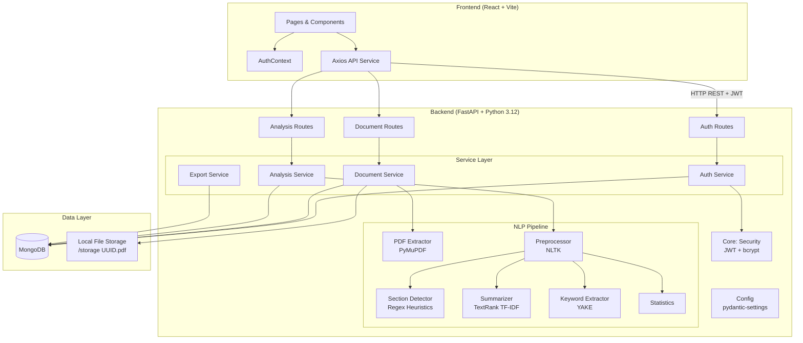
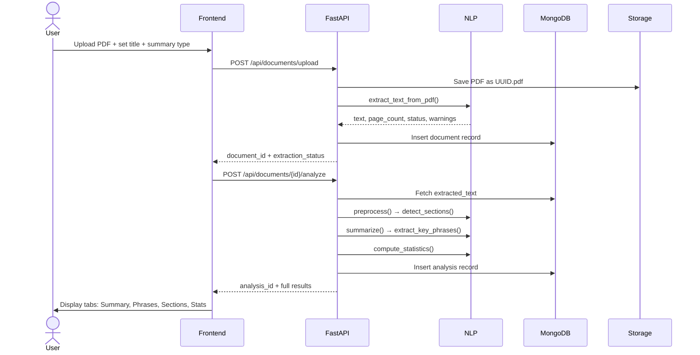

# System Architecture

## Architecture Diagram

## Component Responsibilities

| Component | Responsibility |
|-----------|---------------|
| **React Pages** | UI rendering, user input, navigation |
| **AuthContext** | JWT storage, token validation on startup |
| **Axios Service** | Token injection, 401 handling, typed API helpers |
| **FastAPI Routes** | HTTP endpoint definitions, request validation |
| **Auth Service** | Registration, login, password hashing, JWT creation |
| **Document Service** | File validation, UUID storage, PDF text extraction |
| **Analysis Service** | NLP pipeline orchestration, MongoDB persistence |
| **Export Service** | TXT/PDF report generation |
| **NLP: Extractor** | PyMuPDF PDF text extraction, quality detection |
| **NLP: Preprocessor** | Normalisation, sentence/paragraph splitting |
| **NLP: Section Detector** | Regex-based heading detection |
| **NLP: Summarizer** | TextRank PageRank + TF-IDF extractive summarisation |
| **NLP: Keyword Extractor** | YAKE phrase ranking + deduplication |
| **NLP: Statistics** | Word/sentence/reading-time calculation |
| **MongoDB** | User profiles, document metadata, analysis results |
| **File Storage** | Uploaded PDFs stored with opaque UUID filenames |

## Processing Workflow

## Security Design

- **Passwords**: bcrypt via passlib (never stored in plaintext)
- **Auth**: JWT Bearer tokens, validated on every protected route
- **Ownership**: Every document/analysis query includes `user_id` filter
- **File storage**: Opaque UUID filenames; storage paths never returned to clients
- **Input validation**: Pydantic schemas on all endpoints
- **CORS**: Restricted to configured origins
- **Error messages**: Generic for auth failures (no email enumeration)
