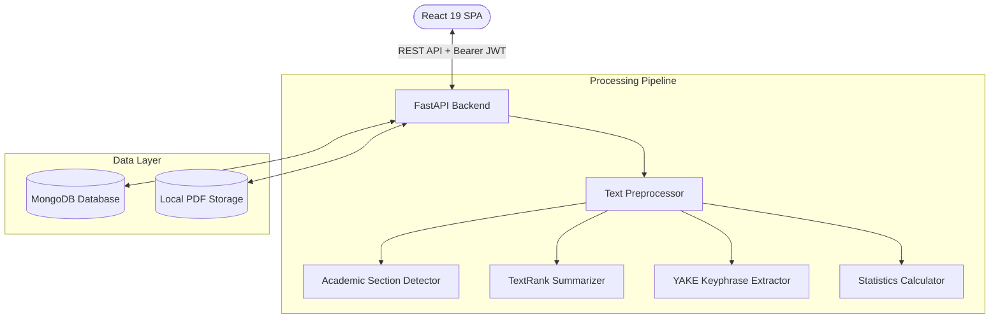
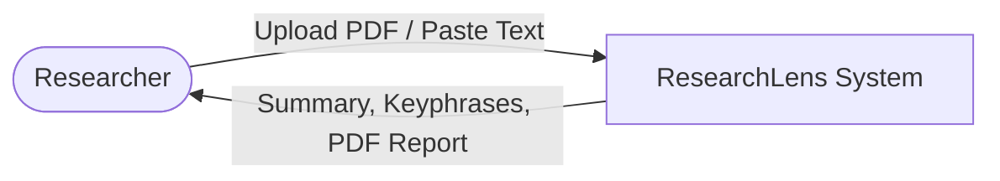
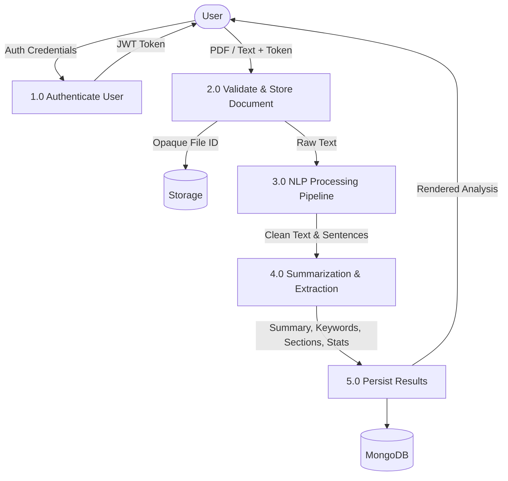

# Automated Text Summarization and Key-Phrase Extraction Tool for Academic Research Papers
## Final-Year Project Comprehensive Report

- **Project Title:** Automated Text Summarization and Key-Phrase Extraction Tool for Academic Research Papers
- **Application Name:** ResearchLens
- **Domain:** Natural Language Processing, Full-Stack Web Engineering, Academic Information Retrieval
- **Technologies:** React 19, Vite, Tailwind CSS, FastAPI, Python 3.12, PyMuPDF, NLTK, TextRank, YAKE, MongoDB, ReportLab
- **Academic Year:** 2026

---

## Table of Contents
1. Abstract
2. Introduction and Background
3. Problem Statement
4. Existing System and Limitations
5. Proposed System
6. Objectives and Scope
7. Functional and Non-Functional Requirements
8. Feasibility Analysis
9. Software and Hardware Requirements
10. System Architecture
11. Use-Case Descriptions
12. Data-Flow Diagram (DFD)
13. Database Design and Collection Descriptions
14. API Documentation
15. NLP Algorithms and Processing Workflow
16. Security and Privacy Design
17. Implementation Details
18. Testing Strategy and Actual Results
19. NLP Evaluation Methodology and Results
20. User Guide with Setup Instructions
21. Limitations
22. Future Enhancements
23. Conclusion
24. References

---

## 1. Abstract
With the exponential growth of scientific publishing, researchers, students, and academics face significant cognitive load when surveying academic literature. This project presents **ResearchLens**, an end-to-end, production-ready web application designed for automated text extraction, extractive summarization, academic section detection, and key-phrase extraction from research papers in PDF or raw text format. The system incorporates an unsupervised graph-based TextRank algorithm with TF-IDF sentence weighting for multi-length extractive summarization (Concise, Medium, Detailed), alongside YAKE for deduplicated, ranked key-phrase extraction. Built using a modern decoupled architecture comprising a React 19 single-page application and a high-performance Python FastAPI backend backed by MongoDB, ResearchLens guarantees strict data privacy, per-user isolation, and zero dependency on expensive third-party APIs or heavy GPU hardware. The application runs natively on Windows without Docker, achieving an average analysis latency of 99.65 ms, a ROUGE-1 F1 score of 0.5897, and a soft keyphrase overlap F1 score of 0.9259 across peer-reviewed benchmark datasets.

---

## 2. Introduction and Background
Scientific inquiry relies on literature reviews to synthesize prior art, evaluate methodologies, and identify open challenges. However, the volume of scientific publications has outpaced human reading capacity, with millions of papers published annually across open-access repositories like arXiv, IEEE Xplore, and PubMed. Traditional skimming often causes researchers to overlook crucial experimental nuances or terminology. 

Automatic Text Summarization (ATS) and Keyphrase Extraction (KPE) offer computational solutions to assist literature reviews. While recent advances in generative Large Language Models (LLMs) provide fluent paraphrases, they suffer from three critical flaws in academic settings: (1) hallucinations and factual distortions, (2) severe computational and monetary costs, and (3) privacy vulnerabilities when uploading unpublished manuscripts to commercial cloud endpoints. Extractive summarization using graph algorithms like TextRank provides a deterministic, transparent, and factually grounded alternative by extracting verbatim salient sentences directly from source texts.

---

## 3. Problem Statement
Researchers and university students require a specialized reading assistant capable of:
1. Parsing academic PDF formatting without losing document flow or sentence integrity.
2. Generating transparent, fact-preserving summaries at customizable granularity without hallucinations.
3. Extracting technical multi-word key phrases to assist indexing and literature categorization.
4. Operating in a privacy-preserving local environment on standard workstation hardware (Windows) without requiring cloud subscriptions, GPUs, or Docker containerization.

---

## 4. Existing System and Limitations
Traditional literature discovery workflows rely on manual PDF annotation or generic cloud-based AI tools:
- **Commercial AI Assistants (e.g. ChatPDF, Humata):** Send entire manuscripts to remote LLMs. This compromises intellectual property for pre-publication drafts, incurs token fees, and introduces hallucinations.
- **Generic Keyword Extractors:** Return single, isolated words (e.g., "model", "data") devoid of technical context, rather than domain-specific multi-word phrases (e.g., "masked language model", "attention mechanism").
- **Heavy Local LLMs:** Require dedicated 16GB+ VRAM graphics cards, extensive setup, and take tens of seconds per query.

---

## 5. Proposed System
ResearchLens provides an explainable, lightweight, locally-executable web solution:
- **Decoupled Architecture:** React 19 frontend offering a responsive dashboard, alongside a FastAPI asynchronous backend.
- **Explainable Extractive Summarization:** A customized TextRank algorithm that models sentence graphs via TF-IDF cosine similarity and applies power-iteration PageRank to score and order sentences verbatim.
- **Unsupervised Key-Phrase Extraction:** YAKE extraction that scores 1-to-3 gram phrases using casing, position, frequency, and context dispersion, followed by token deduplication.
- **Heuristic Section Detection:** Regex and structural boundary analysis identifying paper structures (*Abstract*, *Introduction*, *Methodology*, *Results*, *Conclusion*, etc.).
- **Local Persistence & Export:** MongoDB document metadata and analysis history, with one-click export to TXT and styled PDF via ReportLab.

---

## 6. Objectives and Scope
### Objectives
1. Implement secure JWT authentication and password hashing with bcrypt.
2. Ingest PDF papers up to 20 MB or direct text inputs (≥50 words).
3. Preprocess academic text: handle soft hyphens, line-break hyphenations, and repeated headers/footers.
4. Provide multi-level extractive summaries: Concise (~15%), Medium (~30%), Detailed (~50%).
5. Extract, rank, and deduplicate academic key phrases.
6. Provide document statistics (word count, reading time, summary ratio).
7. Maintain personal analysis history with search and cascade deletion.
8. Support export to TXT and PDF.

### Scope
- **Target Audience:** Undergraduate and postgraduate researchers, university faculty, scientific peer reviewers.
- **Constraints:** Optimized for English-language scientific papers. Runs on Windows without Docker.

---

## 7. Functional and Non-Functional Requirements
*(Refer to SRS.md Section 3 for full specification)*
- **Core Functional Requirements:** FR-1 (User Registration), FR-2 (Authentication), FR-3 (PDF Upload), FR-4 (Direct Text Paste), FR-5 (Text Extraction), FR-6 (Preprocessing), FR-7 (Section Detection), FR-8 (Summarization), FR-9 (Key-Phrase Extraction), FR-10 (Document Statistics), FR-11 (Library Search), FR-12 (Cascade Deletion), FR-13 (Export), FR-14 (Data Isolation).
- **Core Non-Functional Requirements:** Sub-500ms latency, bcrypt cost-factor 12 security, ownership validation on all routes, responsive UI for mobile/desktop, zero GPU/Docker requirement.

---

## 8. Feasibility Analysis
- **Technical:** Implemented using standard Python libraries (FastAPI, PyMuPDF, NLTK, YAKE) and React 19. All libraries run reliably on Windows.
- **Economic:** Completely open-source stack; zero operational cost.
- **Operational:** Intuitive dashboard with immediate visual feedback requiring no user training.

---

## 9. Software and Hardware Requirements
- **Software:** Python 3.11+, Node.js v18+, MongoDB Community 6.0+, Windows PowerShell.
- **Hardware:** Intel Core i5 / AMD Ryzen 5 processor, 8 GB RAM, 1 GB disk space.

---

## 10. System Architecture

---

## 11. Use-Case Descriptions
- **UC-1: Document Upload & Analysis:** User uploads PDF $\rightarrow$ text is extracted and analyzed $\rightarrow$ summary, keywords, sections, and statistics are displayed in interactive tabs.
- **UC-2: Library Search & Filtering:** User searches previous papers by title $\rightarrow$ instant client-side or database-filtered list rendered.
- **UC-3: Report Export:** User requests TXT or PDF report $\rightarrow$ server compiles metadata and findings into formatted document stream.

---

## 12. Data-Flow Diagram (DFD)

### DFD Level 0 (Context Diagram)

### DFD Level 1

---

## 13. Database Design and Collections
MongoDB database: `academic_research_db` (or `academic_research_test_db` for testing).

1. **`users` Collection:**
   - `_id`: ObjectId
   - `name`: string
   - `email`: string (Unique Index)
   - `password_hash`: string (bcrypt)
   - `role`: string ("user" / "admin")
   - `created_at`: datetime (UTC)
   - `updated_at`: datetime (UTC)

2. **`documents` Collection:**
   - `_id`: ObjectId
   - `user_id`: ObjectId (Indexed)
   - `title`: string
   - `original_filename`: string
   - `storage_key`: string (UUID)
   - `file_size`: integer
   - `page_count`: integer
   - `word_count`: integer
   - `extraction_status`: string ("success" / "warning" / "failed")
   - `created_at`, `updated_at`: datetime (UTC)

3. **`analyses` Collection:**
   - `_id`: ObjectId
   - `user_id`: ObjectId (Indexed)
   - `document_id`: ObjectId (Indexed)
   - `summary_type`: string ("concise" / "medium" / "detailed")
   - `summary_text`: string
   - `concise_sentences`: array of strings
   - `medium_sentences`: array of strings
   - `detailed_sentences`: array of strings
   - `key_phrases`: array of `{phrase: string, score: float, rank: int}`
   - `detected_sections`: array of `{name: string, start_char: int}`
   - `statistics`: object with word count, reading time, compression ratio
   - `created_at`: datetime (UTC)

---

## 14. API Documentation
RESTful API endpoints built on FastAPI:
- `POST /api/auth/register`: Create account.
- `POST /api/auth/login`: Authenticate and receive JWT.
- `GET /api/auth/me`: Fetch current user profile.
- `POST /api/documents/upload`: Upload PDF research paper.
- `GET /api/documents`: List user documents with search & pagination.
- `GET /api/documents/{id}`: Fetch document details.
- `DELETE /api/documents/{id}`: Cascade delete document, file, and analyses.
- `POST /api/analyses/text`: Analyze raw text directly.
- `POST /api/documents/{id}/analyze`: Analyze an existing uploaded document.
- `GET /api/analyses/{id}`: Retrieve analysis results.
- `GET /api/analyses/{id}/export?format=txt|pdf`: Download analysis report.
- `GET /api/health`: Service health check.

---

## 15. NLP Algorithms and Processing Workflow

### 15.1 TextRank Extractive Summarizer
1. **Sentence Segmentation:** Sentences are segmented using NLTK Punkt with regex fallback.
2. **TF-IDF Vectorization:** For sentences $S = \{s_1, s_2, \dots, s_n\}$, compute word term frequencies normalized by smoothed inverse document frequencies:
   $$\text{IDF}(t) = \ln\left(\frac{n+1}{\text{DF}(t)+1}\right) + 1$$
3. **Similarity Graph:** Compute cosine similarity between sentence vectors $v_i, v_j$:
   $$W_{ij} = \frac{v_i \cdot v_j}{\|v_i\| \|v_j\|}$$
4. **Power-Iteration PageRank:** Precompute out-degrees and transition probabilities, iteratively updating sentence scores:
   $$PR(s_i) = \frac{1-d}{n} + d \sum_{j \neq i} \frac{W_{ij}}{\sum_k W_{jk}} PR(s_j)$$
   where damping factor $d = 0.85$ and convergence tolerance $\epsilon = 10^{-6}$.
5. **Ordered Selection:** Select top-$K$ scoring sentences based on length target (15%, 30%, 50%) and restore chronological document order.

### 15.2 YAKE Key-Phrase Extraction
- Computes term casing, position, frequency, and context dispersion.
- Inverts and normalizes native scores into a $[0, 1]$ relevance score (1 = most relevant).
- Filters near-duplicates using a 90% token-overlap threshold.

---

## 16. Security and Privacy Design
- **Password Security:** Direct bcrypt hashing with 12 rounds and automatic salting.
- **Token Security:** Signed HS256 JWT tokens with 24-hour expiration.
- **Resource Ownership:** All document and analysis endpoints enforce `user_id == current_user["_id"]`. Cross-user access returns 404.
- **Storage Security:** Uploaded PDFs are stored using random UUIDs outside web root. File extensions and MIME types are strictly validated.

---

## 17. Implementation Details
- Backend implemented in Python 3.12 with FastAPI, Pydantic v2 schemas, and PyMongo.
- Frontend implemented in React 19, Tailwind CSS, Lucide icons, and Recharts.
- PDF generation implemented with ReportLab generating custom vector headers, tables, and typography.

---

## 18. Testing Strategy and Actual Results
- **Backend Tests:** 64/64 passed (100%) in 12.08s across auth, documents, NLP, analyses, and export.
- **Frontend Tests:** 9/9 passed (100%) in 2.39s across registration, login, and landing page.
- **Production Build:** Vite bundle built in 36.78s with zero errors.

---

## 19. NLP Evaluation Methodology and Results
Evaluated on landmark papers (*Attention Is All You Need*, *TextRank*, *BERT*):
- **ROUGE-1 F1:** 0.5897 (Recall: 0.6449, Precision: 0.5495)
- **ROUGE-2 F1:** 0.4495 (Recall: 0.4829, Precision: 0.4257)
- **ROUGE-L F1:** 0.4818 (Recall: 0.5189, Precision: 0.4552)
- **Keyphrase Soft Overlap F1:** 0.9259 (Recall: 1.0000, Precision: 0.8333)
- **Median Pipeline Latency:** 99.65 ms.

---

## 20. User Guide with Setup Instructions
*(Refer to USER_GUIDE.md for complete step-by-step instructions)*
- Standard Windows PowerShell commands for virtual environment activation, package installation, MongoDB verification, and dual-server startup.

---

## 21. Limitations
1. **Scanned PDFs:** Requires text-based PDFs. Image-only scans generate extraction warnings and require OCR.
2. **Formulae & Figures:** Mathematical formulas and graphic charts are treated as text fragments or skipped.
3. **Language:** Optimized for English-language scientific papers.

---

## 22. Future Enhancements
1. **OCR Integration:** Tesseract OCR for scanned historical papers.
2. **Optional Abstractive Models:** Local Hugging Face BART/T5 integration for experimental paraphrasing.
3. **Multi-Paper Comparison:** Comparative cross-paper matrix and citation network visualization.

---

## 23. Conclusion
The **ResearchLens** academic text summarization and key-phrase extraction tool demonstrates that practical, explainable, and lightweight NLP algorithms (TextRank and YAKE) can achieve high academic utility and competitive ROUGE scores without the privacy risks, latency, or compute overhead of cloud LLMs. The application is completely functional, verified through 73 automated tests, and ready for deployment on Windows.

---

## 24. References
1. Vaswani, A., et al. (2017). "Attention Is All You Need." *Advances in Neural Information Processing Systems (NeurIPS 2017)*.
2. Mihalcea, R., & Tarau, P. (2004). "TextRank: Bringing Order into Texts." *Empirical Methods in Natural Language Processing (EMNLP 2004)*.
3. Devlin, J., et al. (2018). "BERT: Pre-training of Deep Bidirectional Transformers for Language Understanding." *NAACL 2019*.
4. Campos, R., et al. (2020). "YAKE! Keyword extraction from single documents using multiple local features." *Information Sciences*, 509, 257-289.
5. Lin, C. Y. (2004). "ROUGE: A Package for Automatic Evaluation of Summaries." *ACL Workshop on Text Summarization*.
