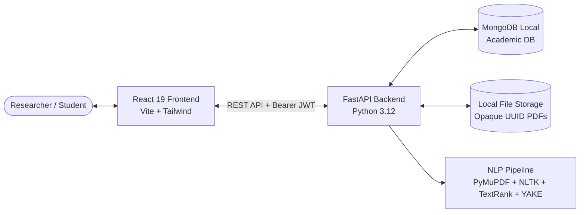

# Software Requirements Specification (SRS)

## Project Title
**Automated Text Summarization and Key-Phrase Extraction Tool for Academic Research Papers**

- **Version:** 1.0  
- **Academic Year:** Final Year (S7/S8)  
- **Status:** Baseline Implementation Verified  
- **Date:** October 2026  

---

## 1. Introduction

### 1.1 Purpose
This Software Requirements Specification (SRS) defines the functional and non-functional requirements, architectural design, data models, interfaces, constraints, and verification criteria for **ResearchLens**, an automated web-based academic research assistant. The tool processes English-language academic research papers in PDF or raw text format, extracts extractable content, performs heuristic section detection, generates multi-level extractive summaries, identifies and ranks key phrases, computes reading statistics, and supports secure export and history management.

### 1.2 Problem Statement
Undergraduate students, postgraduate researchers, and academic faculty face exponential growth in published scientific literature. Surveying related literature, identifying core methodologies, extracting key technical terminology, and understanding contributions requires extensive manual reading time. 

Existing commercial tools either:
1. Rely on expensive, proprietary cloud APIs with privacy risks regarding unpublished manuscripts.
2. Require heavy GPU resources, complex containerization (Docker), or high-latency LLM calls.
3. Obscure whether summaries are hallucinated paraphrases or faithful representations of the source.

There is a distinct need for a lightweight, transparent, privacy-respecting, and fully local academic research assistant that runs efficiently on standard workstation hardware (Windows) without GPU dependency.

### 1.3 Objectives
1. **Secure Access:** Provide user authentication using JWT and bcrypt password hashing.
2. **Flexible Ingestion:** Accept PDF uploads (up to 20 MB) or direct text pasting.
3. **Robust Text Extraction:** Extract text, metadata, and page counts from PDFs using PyMuPDF while detecting image-only or low-quality documents.
4. **Structural Preprocessing:** Clean whitespace, resolve hyphenated line-breaks, strip repeated headers/footers, and segment text into sentences and paragraphs.
5. **Section Detection:** Heuristically identify academic sections (*Abstract*, *Introduction*, *Methodology*, *Results*, *Discussion*, *Conclusion*, *References*).
6. **Multi-Length Summarization:** Generate concise (15%), medium (30%), and detailed (50%) extractive summaries using a graph-based TextRank algorithm.
7. **Ranked Key-Phrase Extraction:** Extract and rank academic key phrases using YAKE with token deduplication.
8. **Quantitative Statistics:** Compute word count, sentence count, reading time, and summary compression ratios.
9. **Research Library:** Maintain an isolated personal history of analyzed documents with search, filter, and pagination.
10. **Data Export:** Export structured reports to TXT and formatted PDF (ReportLab).
11. **Responsible Disclosure:** Clearly flag machine-generated output to remind users to review source text.

### 1.4 Scope
- **In-Scope (MVP & Production Baseline):**
  - English-language research papers.
  - PyMuPDF text extraction.
  - TextRank extractive summarization with cosine similarity and TF-IDF.
  - YAKE unsupervised key-phrase extraction.
  - MongoDB per-user document and analysis persistence.
  - React 19 + Tailwind CSS + Lucide React responsive dashboard.
  - Formatted TXT and PDF report generation.
  - Windows local development without Docker.
- **Out-of-Scope (Future Enhancements):**
  - Scanned PDF optical character recognition (Tesseract OCR).
  - Training deep transformer models from scratch.
  - Multi-paper cross-comparison and synthesis.
  - Parsing mathematical equations as LaTeX or raster charts.
  - Multilingual paper analysis.

---

## 2. Overall Description

### 2.1 Product Perspective
ResearchLens operates as an independent client-server web application. The frontend communicates with the backend exclusively via RESTful JSON APIs and multipart file uploads over HTTP with JWT authentication.

### 2.2 User Characteristics
- **Students & Researchers:** Need fast extraction of key contributions, terminology, and summaries for literature reviews.
- **Academic Reviewers:** Need quick structural navigation and verification of section contents against source text.

---

## 3. Specific Requirements

### 3.1 Functional Requirements (FR)

| Req ID | Module | Description | Priority |
|---|---|---|---|
| **FR-1** | Auth | User registration with name, unique email, and strong password (≥8 chars, 1 uppercase, 1 digit). | High |
| **FR-2** | Auth | User login issuing signed JWT with configurable expiration. | High |
| **FR-3** | Documents | PDF file upload (≤20 MB) with type verification and opaque UUID storage. | High |
| **FR-4** | Ingestion | Direct text paste with title and minimum length validation (≥50 words). | High |
| **FR-5** | Extraction | Text extraction with page count, metadata, and empty/scanned PDF warnings. | High |
| **FR-6** | Preprocessing | Normalization of line endings, removal of soft hyphens, line-break hyphenation repair, and repeated header/footer suppression. | High |
| **FR-7** | Section Detection | Best-effort heuristic identification of common academic headings and offsets. | Medium |
| **FR-8** | Summarization | Extractive summarization producing concise, medium, and detailed summaries via TextRank PageRank scoring. | High |
| **FR-9** | Keywords | Extraction and ranking of 1- to 3-gram key phrases using YAKE with token overlap deduplication. | High |
| **FR-10** | Statistics | Computation of word count, character count, sentence count, paragraph count, and reading time. | High |
| **FR-11** | Library | Per-user research library with case-insensitive search, pagination, and sorting. | High |
| **FR-12** | Deletion | Cascade deletion of document record, stored physical file, and all linked analyses. | High |
| **FR-13** | Export | One-click export of analysis results to TXT and styled PDF format. | High |
| **FR-14** | Isolation | Strict per-user data isolation: users cannot view, query, or delete other users' assets. | High |

### 3.2 Non-Functional Requirements (NFR)

| Req ID | Category | Requirement Specification |
|---|---|---|
| **NFR-1** | **Performance** | Total NLP analysis time on standard research paper excerpts (<2,000 words) must be under 500 ms (Actual achieved: ~100 ms). |
| **NFR-2** | **Security** | Passwords must be hashed using bcrypt (cost factor 12). Plaintext passwords must never be logged or stored. |
| **NFR-3** | **Data Isolation** | All document and analysis endpoints must check ownership (`user_id`). Access to non-owned resources returns 404. |
| **NFR-4** | **Reliability** | The system must gracefully handle malformed, encrypted, or zero-text PDFs with explanatory user warnings. |
| **NFR-5** | **Portability** | Must execute natively on Windows PowerShell using standard Python venv and Node.js without Docker dependencies. |
| **NFR-6** | **Usability** | Responsive web interface suitable for desktop (1920x1080), tablet (768px), and mobile (375px) viewports. |
| **NFR-7** | **Auditability** | Record creation and update UTC timestamps for users, documents, and analysis runs. |
| **NFR-8** | **Extensibility** | Modular NLP pipeline allowing drop-in substitution of abstractive models (e.g. Hugging Face T5/BART) without altering API schemas. |

---

## 4. Use Case Specifications

### Use Case 1: Upload Paper & Generate Multi-Length Summary
- **Actor:** Authenticated Researcher.
- **Preconditions:** User is logged in and on the `/upload` route.
- **Main Flow:**
  1. User selects a PDF research paper via drag-and-drop or file browser.
  2. User specifies a document title and selects "Medium" summary length.
  3. System validates file size and extension, writes file to disk with UUID key, and extracts text via PyMuPDF.
  4. System runs preprocessing, section detection, TextRank summarization, YAKE keyword extraction, and statistics calculation.
  5. Analysis record is persisted to MongoDB.
  6. User is redirected to `/analyses/{analysis_id}` displaying overview, summary tabs, ranked phrases, sections, statistics, and source viewer.

### Use Case 2: Library Search and Export
- **Actor:** Authenticated Researcher.
- **Preconditions:** User has previously analyzed papers in their library.
- **Main Flow:**
  1. User navigates to `/library`.
  2. User enters a keyword query in the search bar.
  3. Frontend requests filtered document list from `GET /api/documents?search={query}`.
  4. User clicks "Open Analysis" on a matching document.
  5. User clicks "Export PDF" or "Export TXT".
  6. Backend streams generated document with proper headers, prompting browser download.

---

## 5. Feasibility Analysis

1. **Technical Feasibility:** High. Utilizes proven, lightweight algorithms (TextRank TF-IDF, YAKE, PyMuPDF) running on standard CPUs without GPU requirements.
2. **Economic Feasibility:** High. 100% open-source stack (Python, FastAPI, MongoDB Community, React, Vite, Tailwind CSS). No recurring third-party API costs.
3. **Operational Feasibility:** High. Intuitive academic dashboard with immediate visual feedback, responsive layouts, and zero installation overhead for clients.

---

## 6. Hardware and Software Specifications

### 6.1 Development & Server Environment
- **Operating System:** Windows 10 / 11 (64-bit)
- **Processor:** Intel Core i5 / AMD Ryzen 5 or higher
- **RAM:** Minimum 8 GB (16 GB recommended)
- **Storage:** 1 GB free disk space for dependencies and storage
- **Runtime Engines:** Python 3.11 / 3.12 (64-bit), Node.js v18+ (LTS)
- **Database Engine:** MongoDB Community Server v6.0+ (Local service on port 27017)

### 6.2 Client Environment
- **Supported Browsers:** Google Chrome 110+, Mozilla Firefox 110+, Microsoft Edge 110+, Safari 16+
- **Screen Resolution:** 1280x720 minimum (optimized for 1920x1080)
